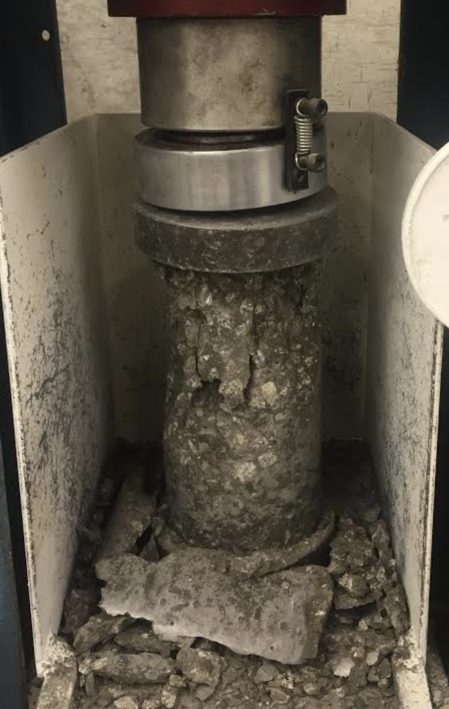
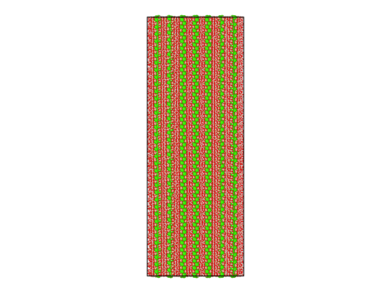
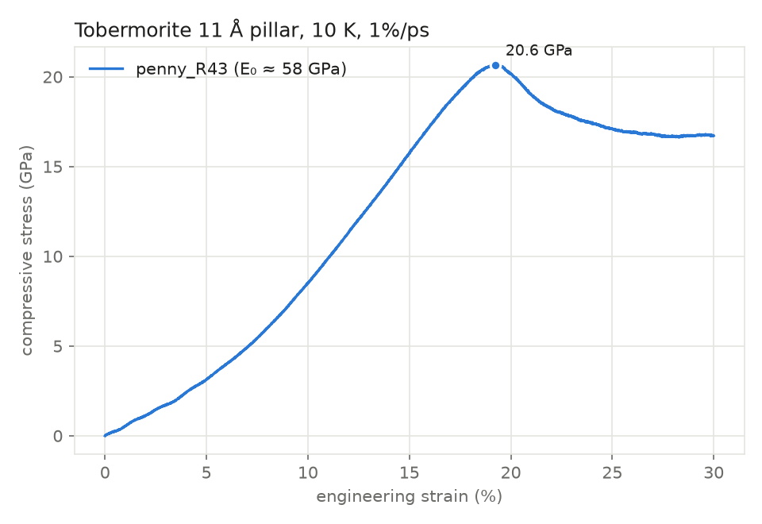
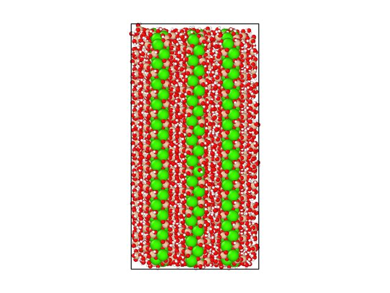
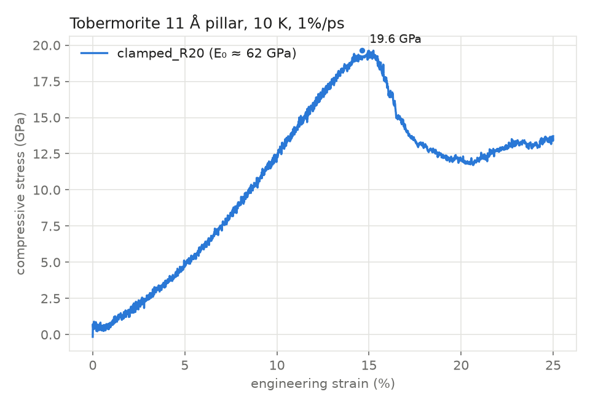
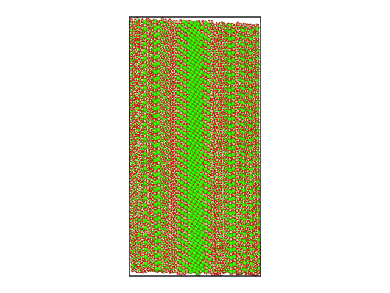
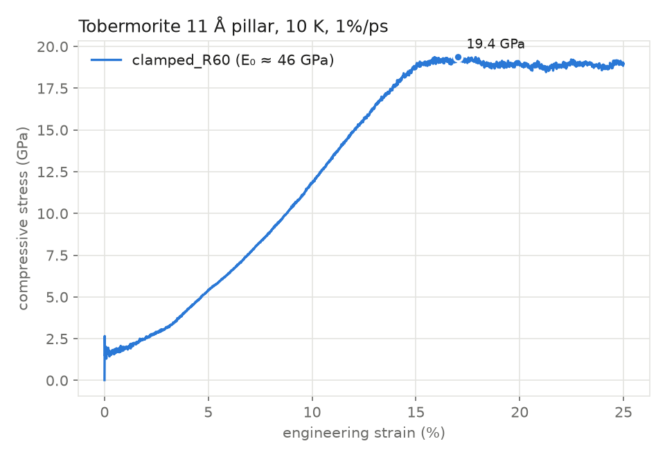

# Tobermorite-11 Å Compression

The motivation of this project is to simulate concrete under compression and 
visualize cracking. Tobermorite is a calcium silicate hydrate mineral that is 
an important binding agent in cement. When Portland cement is mixed with water, 
a tobermorite gel is formed that binds aggregate together and gives concrete 
it's compressive strength. In this project, a Tobermorite-11 Å pillar is 
compressed. Two methods are used to simulate cracking: starting with an 
internal flaw, a penny crack, and clamping the ends of the pillar to create 
sideways tension.

<b>Figure 1:</b> Concrete compression test example.

 

In real life, concrete has small imperfections from which cracks can begin to 
form. A penny crack, a flat circular crack, was added in one of the Ca sheets 
to represent one of these internal flaws. The crack was made by removing 133 
Ca. The goal was to observe cracking originating from the penny crack. The 
build used N = 125,917 atoms, Lz = 252 Å, and R0 = 43.72 Å. See `CRACK_PLAN.md` 
for more information on the penny crack tests.

A shear band forms at the height of the penny crack. This band stays horizontal 
and the pillar exhibits a barreling failure mode. This was a similar result to 
testing a x10 smaller pillar. The second method attempted to modify the design 
to show brittle axial splitting.

    <b>Figure 2:</b> Compression of tobermorite pillar with penny crack. Ca, 
    Si, O, and H are shown in green, beige, red, and white respectively.

 

    <b>Figure 3:</b> Stress-strain graph for tobermorite pillar with penny 
    crack. Peak 20.6 GPa at 19.3% strain.

 

    <b>Figure 4:</b> Damage map for tobermorite pillar with penny crack. Sheer 
    concentrates around the penny crack, forming a horizontal band after peak 
    compression.

 

The Poisson effect states that a solid squeezed along it's length will get 
shorter and wider. Khodadd et al. (2026) proposes that splitting in a brittle 
material is driven by loading boundaries. Therefore, splitting should not start 
as the whole pillar widens uniformly. If the ends of the pillar cannot spread 
sideways, the middle still bulges, creating a region of sideways tension. This 
test removes the penny crack and clamps the ends of the pillar. An 8 Å layer of 
atoms at each end is made rigid. These builds used N = 8,969 atoms, L = 80 Å, 
and R = 20 Å and N = 228,401 atoms, L = 240 Å, and R = 60 Å. The larger pillar 
is about x25 the size of the smaller pillar. See `SPLIT_PLAN.md` for more 
information on the clamped pillar tests.

    <b>Figure 5:</b> Compression of 8,969 atoms tobermorite pillar with clamped 
    ends. Ca, Si, O, and H are shown in green, beige, red, and white 
    respectively.

 

    <b>Figure 6:</b> Stress-strain graph for 8,969 atoms tobermorite pillar 
    with clamped ends.

 

    <b>Figure 7:</b> (Left side) Compression of 228,401 atoms tobermorite 
    pillar with clamped ends. Ca, Si, O, and H are shown in green, beige, red, 
    and white respectively.

 

    <b>Figure 8:</b> Stress-strain graph for 228,401 atoms tobermorite pillar 
    with clamped ends.

 

    <b>Figure 9:</b> Damage map for 228,401 atoms tobermorite pillar with 
    clamped ends.

 

> M. Khodadd, F. Barthelat, J. D. Clayton, G. Gazonas, and K. Dayal, 
> "Compressive Splitting in Brittle Solids: The Inverse of Wrinkling in Sheets," 
> *Physical Review Letters*, vol. 137, no. 19, Nov. 2026. doi: 10.1103/j8x1-hy4t
